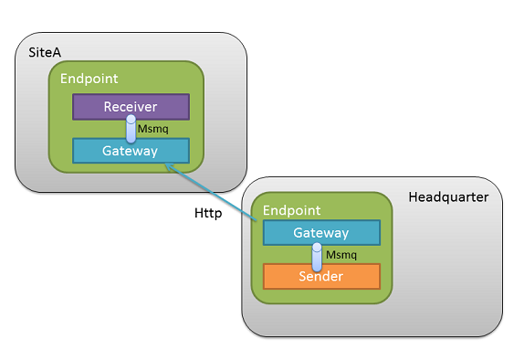
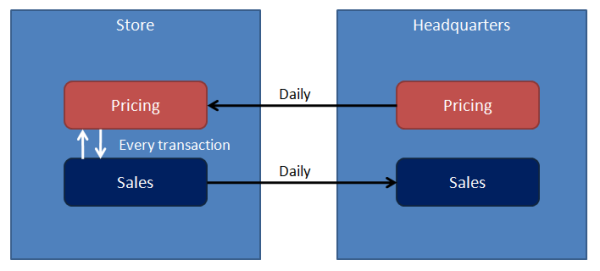

NServiceBus endpoints normally communicate through a shared [transport](/transports/): every endpoint sends to and receives from the same broker, database, or set of queues. That works when all endpoints can reach that infrastructure. It doesn't work when endpoints are in physically separate sites, such as a headquarters and its retail stores, that have no messaging infrastructure in common and are connected only over HTTP.

The gateway bridges that gap. It moves messages from a queue in one site to a queue in another over HTTP(S), and adds the guarantees that HTTP doesn't provide on its own: retries when the other site is unreachable, and de-duplication when a retry delivers the same message twice. Handlers on the receiving site process the message like any other message; they don't need to know it came from another site.

> [!NOTE]
> "Sites" in this context means distinct physical locations with their own IT infrastructure, not web sites.

## When to use the gateway

Use the gateway only when sites cannot share a transport, for example because security policy prevents a VPN connection or exposing a message broker, or because the connection between sites is slow or unreliable. Consider these alternatives first:

 * If every site can reach a shared transport, such as a [cloud-based message transport](/transports/selecting.md), use it directly. Endpoints in all sites can then send and publish messages normally, and the gateway is not needed.
 * If the sites use different transports but can reach each other's infrastructure, use the [Messaging Bridge](/nservicebus/bridge/).
 * Don't use the gateway as a disaster recovery mechanism between sites. In that scenario all sites are exact replicas: logically a single application, replicated in multiple locations. Use the existing support infrastructure, such as database or storage replication, to keep the sites synchronized.

## How the gateway works

The gateway is not a separate service. It is a feature enabled in an NServiceBus endpoint, and it runs inside that endpoint's process. It sends messages over HTTP(S) as a client, and receives them by listening on an HTTP(S) address called a channel. Every site that receives messages through the gateway needs a channel address that the sending sites can reach, which usually means allowing inbound HTTP(S) traffic into that site.

A message sent from headquarters to a store travels as follows:

 1. Code at headquarters calls `SendToSites`. This sends the message to the gateway's input queue on the headquarters' local transport. The message is now stored durably; nothing has been sent over HTTP yet.
 1. The gateway at headquarters reads the message from that queue and transmits it to the store's gateway over HTTP(S).
 1. If the transmission fails, the gateway at headquarters retries it with increasing delays (see [Recoverability](#using-the-gateway-recoverability)). The message is not lost between attempts.
 1. The store's gateway checks the message ID against its de-duplication storage and discards duplicates. Duplicates occur because HTTP is not transactional: if the response to the sender is lost, the sender cannot tell whether the message arrived, so it retries. A new message is forwarded to the input queue of the store's local endpoint.
 1. A handler at the store processes the message.

## Logically different sites

Sites are _logically different_ when each site differs in behavior from others. In fact, they might also serve completely different business purposes.

One example is a chain of retail stores. The prices of products are specified by people working at headquarters. All the stores in the chain need to know the prices in order to function. Also, all stores send sales reports to headquarters in order to provide them with information for adjusting prices. The prices have to remain effective for a minimum of one day, so it is sufficient for the headquarters to push the price updates to the sites only once per day.

The headquarters site and stores sites are _logically different_, because they have different responsibilities and different logical behaviors:

 * Headquarters - Maintains the prices and pushes price updates to the different stores on a daily basis.
 * Store - Stores the prices locally for read-only purposes, sends sales reports to the headquarters.

The price updates for stores can be modeled as a `DailyPriceUpdatesMessage` message type containing the list of price updates for the coming business day. In this scenario each site needs to receive only one update message per day.

Logically, a daily price update looks like an event that stores could subscribe to, and if all sites shared a transport, publishing it would be a good fit. The gateway does not support publish/subscribe. Instead, messages are sent to named sites explicitly using `SendToSites`.

Sending messages across sites has very different transport characteristics than sending them within a given site. For example, latency will typically be higher, and bandwidth and reliability will be lower. Therefore only dedicated message types should be used for gateway communication in order to explicitly inform developers when they're about to make a cross-site call.

## Features

The gateway supports the following features:

 * Recoverability.
 * De-duplication of messages.
 * Transport level encryption with SSL.
 * Databus for large payloads.
 * HTTP/HTTPS channel implementation.
 * Creation of additional channel types.
 * Listening to multiple channels of different types.

## Using the gateway

### Sending messages to other sites

To send a message to other sites, call the `SendToSites` method:

snippet: SendToSites

`SendToSites` accepts a list of sites to which it should send messages. Note that each site can be configured with a different transport mechanism.

### Configuring the gateway

In NServiceBus version 5 and above, the gateway is provided by the `NServiceBus.Gateway` NuGet package. In version 4 and below the gateway is part of the `NServiceBus` NuGet package.

> [!NOTE]
> The gateway requires NServiceBus persistence to operate though not all persisters support it. Currently, the gateway is supported only by InMemory, RavenDB and Sql persisters. If the configured persister doesn't support gateway, an exception will be thrown at endpoint startup.

The gateway feature must be explicitly enabled using the configuration API:

snippet: GatewayConfiguration

### Recoverability

partial: recoverability

### Version compatibility

The gateway component ensures only forward compatibility for one major version. That means a message sent by the NServiceBus 3.x Gateway can be understood by the NServiceBus 4.x Gateway, and a message sent by the NServiceBus 4.x Gateway can be understood by NServiceBus.Gateway 1.x (the Gateway package targeting NServiceBus 5.x).

However, a message sent by the NServiceBus 3.x Gateway will not be understood by NServiceBus.Gateway 1.x (NServiceBus 5.x) as this skips a major version. Likewise, a message sent by NServiceBus.Gateway 2.x will not be understood by NServiceBus.Gateway 1.x, as backwards communication is not supported.

### Alternate channels

[NServiceBus.Gateway.Channels.HttpVNext](https://github.com/welshdave/NServiceBus.Gateway.Channels.HttpVNext) is a [community package](/nservicebus/community/) that provides an HTTP channel implementation for the Gateway that doesn't use HTTP headers for message content or metadata. This makes it easier to use this channel in situations where HTTP headers may be modified, such as when a gateway is behind a reverse proxy such as NGINX.
