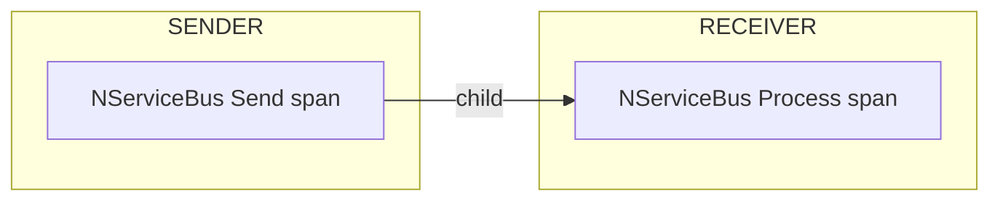
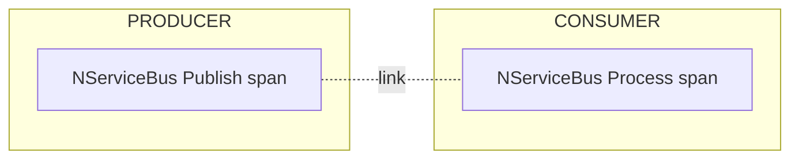
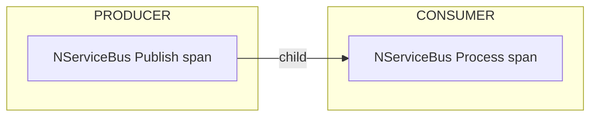
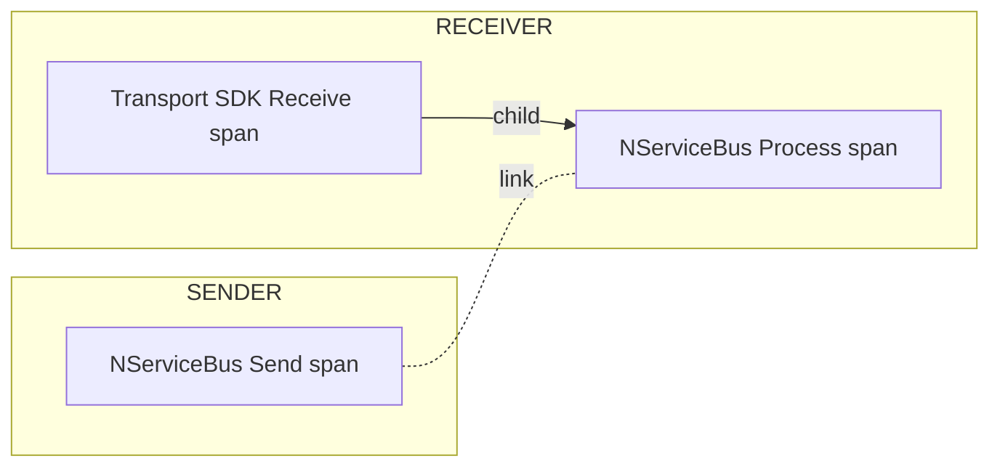

### Trace sources

NServiceBus emits spans from three ActivitySources:

| Source | Description |
|---|---|
| `NServiceBus.Core` | Pipeline spans: send, publish, process |
| `NServiceBus.Core.Handler` | Handler invocation spans (one per handler per message) |
| `NServiceBus.Core.Recoverability` | Recoverability action spans (immediate retry, delayed retry, move to error, discard) |

Subscribe to the sources needed for the endpoint's observability requirements:

snippet: opentelemetry-enabletracing-all-sources

> [!NOTE]
> In version 10, handler spans are emitted from `NServiceBus.Core`. They move to `NServiceBus.Core.Handler` only when the version 11 behavior is enabled, as described under *Version 11 behavior opt-in* below. In version 11 they always come from `NServiceBus.Core.Handler`.
>
> A tracer that subscribes only to `NServiceBus.Core` therefore receives no handler spans once the version 11 behavior is active.

All three sources report version `0.1.0` in version 10, and `1.0.0` when the version 11 behavior is enabled. Use the version to tell the two sets of span names and tags apart.

Subscribing to `NServiceBus.Core.Handler` without subscribing to `NServiceBus.Core` suppresses handler spans - `Activity.Current` inside handlers and behaviors becomes the pipeline span. This enables a flattened trace view where handler work appears directly on the process span.

### Version 11 behavior opt-in

Some OpenTelemetry behaviors change in version 11. Version 10 keeps the version 10 behavior by default. One AppContext switch enables all of the changes together, so an endpoint can adopt the version 11 telemetry before it upgrades:

snippet: opentelemetry-v11-behavior-switch

The switch can also be set without code. With an environment variable:

```text
DOTNET_NServiceBus_Core_OpenTelemetry_UseV11Behavior=true
```

Or in the project file:

```xml
<ItemGroup>
  <RuntimeHostConfigurationOption Include="NServiceBus.Core.OpenTelemetry.UseV11Behavior" Value="true" />
</ItemGroup>
```

The switch is read once, before the endpoint starts, and applies to the whole process. Two endpoints in the same process cannot use different modes.

The switch enables all of these changes:

| Behavior | Version 10 | Version 11 |
|---|---|---|
| Handler span source | `NServiceBus.Core` | `NServiceBus.Core.Handler` |
| ActivitySource version | `0.1.0` | `1.0.0` |
| Parent of the process span under an instrumented transport SDK | NServiceBus send span | SDK receive span, with a link to the send span |
| Span names | generic, for example `process message` | operation and target, for example `process orders` |
| Trace context and baggage propagation | custom propagator | `System.Diagnostics.DistributedContextPropagator` |
| `Start dispatching` and `Finished dispatching` span events | emitted | not emitted |
| Meter name and version | `NServiceBus.Core.Pipeline.Incoming`, `0.4.0` | `NServiceBus.Core`, `1.0.0` |
| Span status on success | `Ok` | `Unset` |
| `execution.result` metric tag | emitted | not emitted |
| `otel.status_code`, `otel.status_description` and `exception.escaped` | emitted on failures | not emitted |
| Outbox deduplication span tag | `nservicebus.outbox.deduplicate-message` | `nservicebus.outbox.deduplicated_message` |
| `nservicebus.event_types` and `nservicebus.enclosed_message_types` span tags | delimited string | array of type names |

> [!WARNING]
> The switch changes what an OpenTelemetry consumer sees. Dashboards, alerts and queries that match on span names, on a span status of `Ok`, on the meter name, on the `execution.result` metric tag, or on the span tags above must be updated. A `MeterProvider` must subscribe to the meter name that matches the switch, or use a wildcard, as described under [Meter name and version](#meters-meter-name-and-version). The baggage wire format changes as well, which affects endpoints that exchange baggage with endpoints that do not have the switch enabled. Read the [version 10 to 11 upgrade guide](/nservicebus/upgrades/10to11/) before the switch is enabled.

In version 11 these behaviors are the only behaviors, and the switch is removed.

### Span relationships

#### Send operations

A span is emitted for each message sent by an NServiceBus endpoint. When the message is received, a receive span is created as a child to the send span.



The default trace behavior for sends is to continue the existing trace: the receiver span is a child of the sender span. To override this for a specific message, use `SendOptions`:

snippet: opentelemetry-sendoptions-start-new-trace

This creates a new trace on the receiver and links the send and receive spans:


#### Publish operations

A span is emitted for each message published by an NServiceBus endpoint. When the message is processed by a subscriber, a process span is created in a new trace, which is linked to the publish span.




The default trace behavior for publishes is to start a new linked trace on each subscriber. To override this for a specific event, use `PublishOptions`:

snippet: opentelemetry-publishoptions-continue-trace

This continues the publisher's trace in the subscriber:



#### Transport SDK spans

Some transport SDKs, such as the Azure Service Bus, RabbitMQ, and Amazon SQS clients, emit their own spans for the native send and receive operations. When the endpoint subscribes to the SDK's ActivitySource, the SDK receive span is the ambient `Activity.Current` at the moment NServiceBus starts processing a message.

In version 10, the default is unchanged in that situation: the NServiceBus process span is a child of the NServiceBus send span. The process span becomes a child of the SDK receive span, with a link back to the NServiceBus send span, when the version 11 behavior is enabled:



If no listener is subscribed to the SDK's ActivitySource, no SDK span exists and the process span is created as described in the sections above, whether or not the switch is set. This is the only behavior in version 11.

### Delayed messages

When a message is delayed - whether by explicit delay (`SendOptions.DelayDeliveryWith`), saga timeout, or delayed retry - a new linked trace is always started at delivery time. This reflects that the receive operation happens at a different moment in time than the send or retry decision.

### Recoverability spans

When a message cannot be processed successfully, NServiceBus emits a recoverability span from the `NServiceBus.Core.Recoverability` ActivitySource. The span carries a `nservicebus.recoverability_action` tag indicating the outcome:

| Tag value | Meaning |
|---|---|
| `immediate_retry` | Message will be retried immediately |
| `delayed_retry` | Message will be retried after a delay |
| `move_to_error` | Message is moved to the error queue |
| `discard` | Message is discarded without further processing |

Recoverability spans are children of the process span. To receive them, subscribe to the `NServiceBus.Core.Recoverability` ActivitySource.

### Span names

In version 10, NServiceBus uses generic operation names for spans, such as `process message` and `publish event`. When the version 11 behavior is enabled, the names follow the OpenTelemetry messaging semantic convention format `{operation} {target}`. The target is the queue for receive and recoverability spans, and the message type name for outgoing spans:

| Operation | Version 10 | Version 11 |
|---|---|---|
| Process | `process message` | `process {receiveAddress}` |
| Send | `send message` | `send message {MessageType}` |
| Publish | `publish event` | `publish {EventType}` |
| Reply | `reply` | `reply {MessageType}` |
| Subscribe | `subscribe event` | `subscribe event {EventType}` |
| Unsubscribe | `unsubscribe event` | `unsubscribe event {EventType}` |
| Immediate retry | `immediate retry` | `immediate retry {receiveAddress}` |
| Delayed retry | `delayed retry` | `delayed retry {receiveAddress}` |
| Move to error | `move to error` | `move to {errorQueue}` |
| Discard | `discard` | `discard` |

A subscribe span for several event types lists the type names separated by spaces. Message type names are short names, not full type names.

### Dispatching events

When outgoing messages are dispatched during message processing, NServiceBus adds two span events to the incoming pipeline span:

- `"Start dispatching"` - emitted before dispatch, includes a `message-count` event tag
- `"Finished dispatching"` - emitted after dispatch completes

These events are emitted in version 10. They are not emitted when the version 11 behavior is enabled, and they are removed in version 11. There is no option to keep them.

### Context propagation

NServiceBus propagates the [W3C Trace Context](https://www.w3.org/TR/trace-context/) and [W3C Baggage](https://www.w3.org/TR/baggage/) headers between endpoints.

In addition to the W3C `traceparent` header, NServiceBus writes the context of the send or publish span to the `NServiceBus.TraceParent` header. Transport SDKs that emit their own spans overwrite `traceparent` on the message with the context of their native send span, and the NServiceBus-specific header keeps the NServiceBus send span reachable for the receiver. Receivers use `NServiceBus.TraceParent` when present and fall back to `traceparent`, so messages from endpoints on versions that only write the W3C header continue the trace as before.

#### Which messages carry trace context

Only messages that flow through the outgoing pipeline - sends, publishes, replies, and delayed messages - receive the context of the current activity. Messages that NServiceBus forwards on behalf of a received message keep the trace headers of that message unchanged:

- Messages moved to the error queue
- Delayed retries
- Audit copies
- Messages forwarded with `IMessageProcessingContext.ForwardCurrentMessageTo`

This keeps the forwarded message correlated to its original sender instead of the span that happened to be active while it was forwarded. Control messages that NServiceBus sends outside the outgoing pipeline, such as message-driven subscribe and unsubscribe requests and ServiceControl retry acknowledgements, carry the current activity's context.

Custom `RecoverabilityAction` and `AuditAction` implementations that forward the received message get the same behavior: the headers are dispatched as they were received, so the trace stays intact without any additional work.

In version 10, NServiceBus uses a custom propagator. Propagation moves to the built-in .NET `DistributedContextPropagator` when the version 11 behavior is enabled, and the custom propagator is removed in version 11. The `baggage` header format changes with it. See the [version 10 to 11 upgrade guide](/nservicebus/upgrades/10to11/) for the serialization details and for the effect on a rolling upgrade.

### Span status

NServiceBus sets the span status to `Ok` when an operation completes without an error. 

### Failed spans and the error.type tag

When a span fails, NServiceBus sets the span status to `Error` and adds an `error.type` tag containing the fully qualified exception type name. This tag is set on the innermost span where the exception was thrown.

See the [OpenTelemetry samples](/samples/open-telemetry/) for instructions on how to send trace information to different tools.
