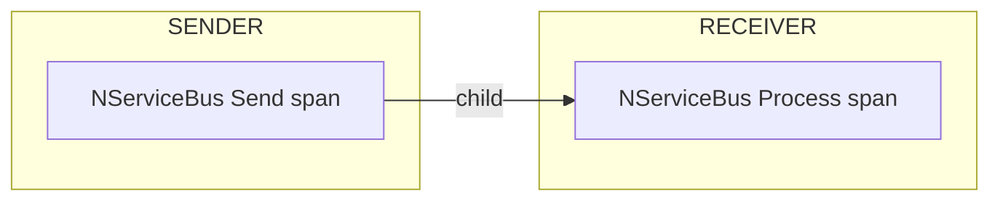
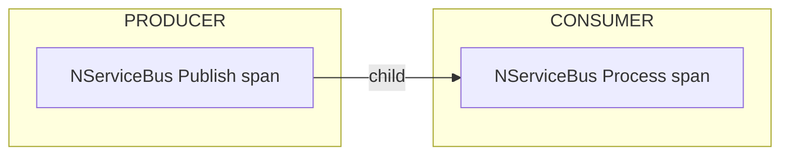
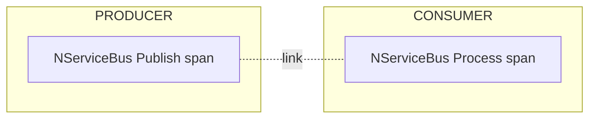
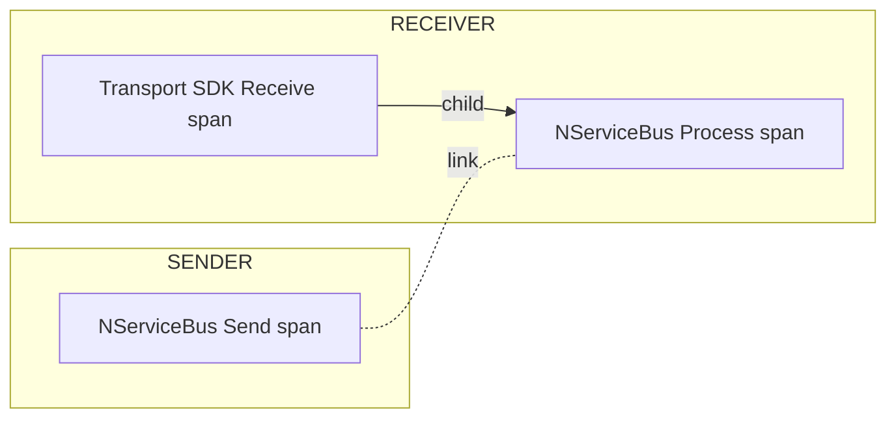

### Trace sources

NServiceBus emits spans from three ActivitySources:

| Source | Description |
|---|---|
| `NServiceBus.Core` | Pipeline spans: send, publish, process |
| `NServiceBus.Core.Handler` | Handler invocation spans (one per handler per message) |
| `NServiceBus.Core.Recoverability` | Recoverability action spans (immediate retry, delayed retry, move to error, discard) |

All three sources report version `1.0.0`. Version 10 reports `0.1.0` and uses a different set of span names and tags.

Subscribe to the sources needed for the endpoint's observability requirements:

snippet: opentelemetry-enabletracing-all-sources

Subscribing to `NServiceBus.Core.Handler` without subscribing to `NServiceBus.Core` enables a flattened trace view where only handler execution is represented in the trace (without any message header tags and without links to the send operation).

### Span relationships

#### Send operations

A span is emitted for each message sent by an NServiceBus endpoint. When the message is received, a receive span is created as a child to the send span.



The default trace behavior for sends is to continue the existing trace: the receiver span is a child of the sender span. To override this for a specific message, use `SendOptions`:

snippet: opentelemetry-sendoptions-start-new-trace

This creates a new trace on the receiver and links the send and receive spans:


To change the default for all sends from an endpoint, set `SendTraceMode`:

snippet: opentelemetry-trace-mode-send

#### Publish operations

A span is emitted for each message published by an NServiceBus endpoint. When the message is processed by a subscriber, a process span is created as a child of the publish span, continuing the publisher's trace.



To start a new trace on the subscribers for a specific event, use `PublishOptions`:

snippet: opentelemetry-publishoptions-start-new-trace

This creates a new trace on each subscriber and links the publish and process spans:



To change the default for all publishes from an endpoint, set `PublishTraceMode`:

snippet: opentelemetry-trace-mode-publish-start-new

Per-message overrides (`StartNewTraceOnReceive`, `ContinueExistingTraceOnReceive`) always take precedence over the endpoint-level defaults.

#### Transport SDK spans

Some transport SDKs, such as the Azure Service Bus, RabbitMQ, and Amazon SQS clients, emit their own spans for the native send and receive operations. When the endpoint subscribes to the SDK's ActivitySource, the SDK receive span is the ambient `Activity.Current` at the moment NServiceBus starts processing a message. The process span is then created as a child of the SDK receive span, with a link back to the NServiceBus send span:



If no listener is subscribed to the SDK's ActivitySource, no SDK span exists and the process span is a child of the NServiceBus send span, as described in the sections above.

### Delayed messages

When a message is delayed - whether by explicit delay (`SendOptions.DelayDeliveryWith`), saga timeout, or delayed retry - a new linked trace is started at delivery time by default. This reflects that the receive operation happens at a different moment in time than the send or retry decision.

The trace behavior for each category of delayed message is configurable independently:

snippet: opentelemetry-trace-mode-delayed

| Option | Default | Applies to |
|---|---|---|
| `DelayedDelivery.SendOperationTraceMode` | `StartNew` | `SendOptions.DelayDeliveryWith` / `DoNotDeliverBefore` |
| `DelayedDelivery.SagaTimeoutTraceMode` | `StartNew` | Saga timeouts (`Saga.RequestTimeout`) |
| `Recoverability.DelayedRetryTraceMode` | `StartNew` | Delayed retries driven by recoverability policy |

### Recoverability spans

When a message cannot be processed successfully, NServiceBus emits a recoverability span from the `NServiceBus.Core.Recoverability` ActivitySource. The span carries a `nservicebus.recoverability_action` tag indicating the outcome:

| Tag value | Meaning |
|---|---|
| `immediate_retry` | Message will be retried immediately |
| `delayed_retry` | Message will be retried after a delay |
| `move_to_error` | Message is moved to the error queue |
| `discard` | Message is discarded without further processing |

Recoverability spans are children of the process span. To receive them, subscribe to the `NServiceBus.Core.Recoverability` ActivitySource.

### Span names

Span names follow the OpenTelemetry messaging semantic convention format `{operation} {target}`. The target is the queue for receive and recoverability spans, and the message type name for outgoing spans:

| Operation | Span name |
|---|---|
| Process | `process {receiveAddress}` |
| Send | `send message {MessageType}` |
| Publish | `publish {EventType}` |
| Reply | `reply {MessageType}` |
| Subscribe | `subscribe event {EventType}` |
| Unsubscribe | `unsubscribe event {EventType}` |
| Immediate retry | `immediate retry {receiveAddress}` |
| Delayed retry | `delayed retry {receiveAddress}` |
| Move to error | `move to {errorQueue}` |
| Discard | `discard` |

A subscribe span for several event types lists the type names separated by spaces. Message type names are short names, not full type names.

### Context propagation

NServiceBus propagates the [W3C Trace Context](https://www.w3.org/TR/trace-context/) and [W3C Baggage](https://www.w3.org/TR/baggage/) headers between endpoints using the built-in .NET `DistributedContextPropagator`.

In addition to the W3C `traceparent` header, NServiceBus writes the context of the send or publish span to the `NServiceBus.TraceParent` header. Transport SDKs that emit their own spans overwrite `traceparent` on the message with the context of their native send span, and the NServiceBus-specific header keeps the NServiceBus send span reachable for the receiver. Receivers use `NServiceBus.TraceParent` when present and fall back to `traceparent`.

#### Which messages carry trace context

Only messages that flow through the outgoing pipeline - sends, publishes, replies, and delayed messages - receive the context of the current activity. Messages that NServiceBus forwards on behalf of a received message keep the trace headers of that message unchanged:

- Messages moved to the error queue
- Delayed retries
- Audit copies
- Messages forwarded with `IMessageProcessingContext.ForwardCurrentMessageTo`

This keeps the forwarded message correlated to its original sender instead of the span that happened to be active while it was forwarded. Control messages that NServiceBus sends outside the outgoing pipeline, such as message-driven subscribe and unsubscribe requests and ServiceControl retry acknowledgements, carry the current activity's context.

Custom `RecoverabilityAction` and `AuditAction` implementations that forward the received message get the same behavior: the headers are dispatched as they were received, so the trace stays intact without any additional work.

### Span status

NServiceBus leaves the span status `Unset` when an operation completes without an error, and sets it to `Error` when the operation fails. It does not set `Ok`. This follows the [OpenTelemetry trace API specification](https://opentelemetry.io/docs/specs/otel/trace/api/#set-status), which reserves `Ok` for application code and operators.

A status set by a handler or behavior is kept.

### Failed spans and the error.type tag

When a span fails, NServiceBus sets the span status to `Error` and adds an `error.type` tag containing the fully qualified exception type name. This tag is set on the innermost span where the exception was thrown.

### Exception recording

When a span fails, NServiceBus records the exception details - the type, message, and stack trace - in the log, not as an event on the span. This follows the [OpenTelemetry semantic conventions for exceptions](https://opentelemetry.io/docs/specs/semconv/exceptions/exceptions-logs/), which define exceptions as log records rather than span events.

NServiceBus logs the exception exactly once, at the point where the recoverability decision is made. The failed span still has the `Error` status and the `error.type` tag, so trace backends show which operation failed.

To see the exception details next to the trace, use a logging provider that attaches the trace context to each log record, such as the OpenTelemetry logging provider for `Microsoft.Extensions.Logging`.

### Startup diagnostics

The effective instrumentation options are written to the `OpenTelemetry` section of the [startup diagnostics](/nservicebus/hosting/startup-diagnostics.md) file. Use this section to verify which trace modes and exception recording mode an endpoint runs with.

```json
"OpenTelemetry": {
  "SendTraceMode": "ContinueExisting",
  "PublishTraceMode": "ContinueExisting",
  "ExceptionRecordingMode": "Logs",
  "Recoverability": {
    "DelayedRetryTraceMode": "StartNew"
  },
  "DelayedDelivery": {
    "SendOperationTraceMode": "StartNew",
    "SagaTimeoutTraceMode": "StartNew"
  }
}
```

See the [OpenTelemetry samples](/samples/open-telemetry/) for instructions on how to send trace information to different tools.
