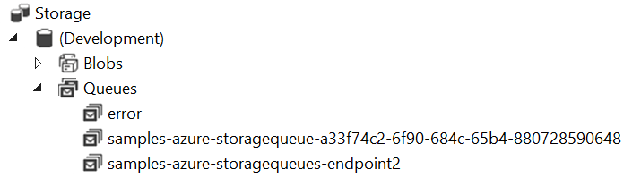

## Prerequisites

Ensure an instance of the [Azurite Emulator](https://learn.microsoft.com/en-us/azure/storage/common/storage-use-azurite?tabs=visual-studio) is running.


## Azure Storage Queues Transport

This sample uses the [Azure Storage Queues Transport](/transports/azure-storage-queues/).


## Code walk-through

This sample shows a simple two-endpoint scenario.

- `Endpoint1` sends a `MyRequest` message to `Endpoint2`.
- `Endpoint2` replies to `Endpoint1` with a `MyResponse`.


### Transport configuration

Both endpoints use the Azure Storage Queues transport with the Azurite development storage connection string (`UseDevelopmentStorage=true`) and the learning persistence.


#### The endpoint configuration

snippet: Config

#### Sanitization

One of the endpoints is using a long name which needs to be sanitized.

snippet: endpointname

The sample registers a sanitizer that converts the name to lowercase, replaces invalid characters with a dash (`-`), and shortens names longer than 63 characters by appending an `MD5` hash. See [Azure Storage Queues name sanitization](/transports/azure-storage-queues/sanitization.md) for the queue naming rules.

snippet: sanitization

The full contents of the sanitization code is shown at the [end of this document](#sanitizer-source-code).


## The data in Azure Storage

The queues for the two endpoints can be seen in the [Server Explorer](https://learn.microsoft.com/en-us/visualstudio/azure/vs-azure-tools-storage-resources-server-explorer-browse-manage) of Visual Studio.




### Reading the data using code

There are several helper methods in `AzureHelper.cs` in the `StorageReader` project. These helpers are used to output the data seen below.


#### Writing Queue Messages

This helper peeks the first message from a given queue and writes out the contents of that message.

snippet: WriteOutQueue


#### Using the helper

snippet: UsingHelpers


### The Message Data

Run only `Endpoint1` and send a message. Notice the contents of the message in the `samples-azure-storagequeues-endpoint2` queue.


### Queue message contents

```json
{
  "IdForCorrelation": null,
  "Id": "5957b746-6636-43c7-89b9-ac6e01853eae",
  "MessageIntent": 1,
  "ReplyToAddress": "samples-azure-storagequeues-endpoint1",
  "TimeToBeReceived": "00:00:00",
  "Headers": {
    "NServiceBus.MessageId": "5957b746-6636-43c7-89b9-ac6e01853eae",
    "NServiceBus.MessageIntent": "Send",
    "NServiceBus.ConversationId": "b01e3778-23a1-42b5-bcbd-ac6e01853eaf",
    "NServiceBus.CorrelationId": "5957b746-6636-43c7-89b9-ac6e01853eae",
    "NServiceBus.ReplyToAddress": "samples-azure-storagequeues-endpoint1",
    "NServiceBus.OriginatingMachine": "BEAST",
    "NServiceBus.OriginatingEndpoint": "Samples-Azure-StorageQueues-Endpoint1",
    "$.diagnostics.originating.hostid": "27bfc91ba004f906eed90fc507597a11",
    "NServiceBus.ContentType": "application/json",
    "NServiceBus.EnclosedMessageTypes": "Endpoint2.MyRequest, Shared, Version=1.0.0.0, Culture=neutral, PublicKeyToken=null",
    "NServiceBus.Version": "7.4.4",
    "NServiceBus.TimeSent": "2020-11-09 23:37:11:901738 Z"
  },
  "Body": "77u/eyJQcm9wZXJ0eSI6IkhlbGxvIGZyb20gRW5kcG9pbnQxIn0=",
  "CorrelationId": "5957b746-6636-43c7-89b9-ac6e01853eae",
  "Recoverable": true
}
```


#### Decoded Body

Note that above there is an encoded `Body` property. Decoding this message will produce the following.

```json
{"Property":"Hello from Endpoint1"}

```

## Sanitizer source code

snippet: BackwardsCompatibleQueueNameSanitizer
