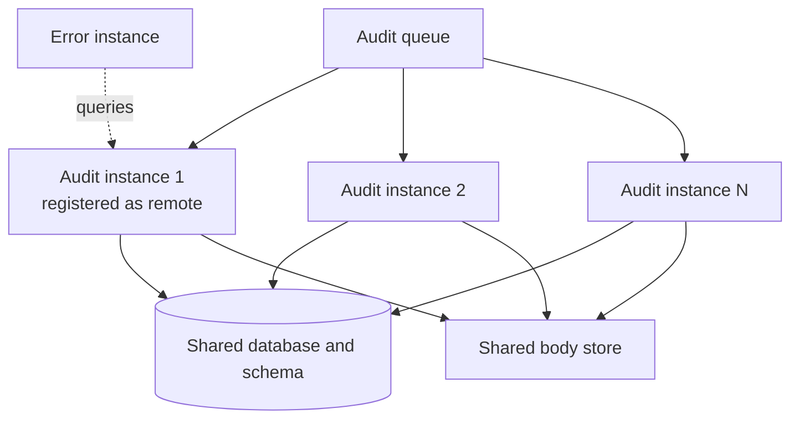

When one ServiceControl Audit instance cannot ingest audit messages fast enough, run additional Audit instances. The instances can read from:

- **The same audit queue:** the instances compete for messages, so each audit message is ingested by exactly one of them. See [sharding audit messages with competing consumers](/servicecontrol/servicecontrol-instances/remotes.md#overview-sharding-audit-messages-with-competing-consumers).
- **Separate audit queues:** endpoints are partitioned into groups, and each group sends audit messages to a different queue, with one or more Audit instances per queue. See [sharding audit messages with split audit queues](/servicecontrol/servicecontrol-instances/remotes.md#overview-sharding-audit-messages-with-split-audit-queues).

Where the instances store data does not depend on which queue they read from. It depends on the storage type:

| Storage | Each additional Audit instance uses | Register as a remote |
| --- | --- | --- |
| RavenDB | Its own RavenDB database | Every instance |
| SQL Server or PostgreSQL, [shared database](#sql-storage-shared-database) | The same database, schema, and message body store as the first instance | Only one instance |
| SQL Server or PostgreSQL, [separate databases](#sql-storage-separate-databases) | Its own database, or its own schema, and its own message body store | Every instance |

## When to scale out

First tune a single instance. See the [performance tuning settings](/servicecontrol/audit-instances/configuration.md#performance-tuning) for the concurrency, batch size, batch timeout, and parallel writer settings.

Add instances only when one instance can no longer keep up, for example when the audit queue keeps growing. Additional instances increase the load on the transport and on storage. Measure the combined result; do not assume linear speedup.

When several instances read from the same queue, the transport must allow several consumers on that queue. Verify this for the transport in use.

Separate audit queues also allow groups of endpoints to keep their audit data for different periods, but only when the instances do not [share a database](#sql-storage-shared-database).

## RavenDB storage

Each Audit instance stores its data in its own RavenDB database: an embedded database for instances deployed with the ServiceControl Management Utility or PowerShell, or a [separate RavenDB container](/servicecontrol/storage/ravendb/containers.md) for container deployments. Do not point two Audit instances at the same RavenDB database.

Register every Audit instance as a [remote instance](/servicecontrol/servicecontrol-instances/remotes.md#overview-sharding-audit-messages-with-competing-consumers) of the Error instance. The Error instance queries each of them and combines the results.

## SQL storage: shared database

With [SQL Server or PostgreSQL storage](/servicecontrol/storage/), additional Audit instances can use the same database and schema as the first instance. All instances write to the same tables, so any one of them can return every ingested audit message, whichever queue it came from. Use this option when ingestion, not the database, is the bottleneck. The following diagram shows instances that read from one queue; instances that read from separate queues share the database in the same way.

Every instance that shares the database must use the same:

- `ServiceControl.Audit/StorageType`, `Database/ConnectionString`, and `Database/Schema` settings.
- `ServiceControl.Audit/MessageBody/*` settings. The instance that answers queries reads bodies that any instance has written, so all instances need permission to read, write, and delete bodies in one shared store. Azure Blob Storage and Amazon S3 are shared by design. File system storage works only when the path is a [shared mount](/servicecontrol/storage/external-body/file.md#setup-and-runtime).
- [`ServiceControl.Audit/AuditRetentionPeriod`](/servicecontrol/audit-instances/configuration.md#data-retention). Each instance removes expired messages from the shared tables and body store, so the shortest retention period applies to all messages.
- ServiceControl version.

> [!WARNING]
> Register only one of the Audit instances that share a database as a [remote instance](/servicecontrol/servicecontrol-instances/remotes.md) of the Error instance. Each of them returns every message in the database, so registering two of them makes ServicePulse show each audit message twice.

If the registered instance stops, audit messages remain in the database, but ServicePulse cannot show them until that instance is available again. The other instances keep ingesting.

### Setup and upgrades

Run setup once, from one instance, before starting the others. The other instances use the schema that setup created.

To upgrade:

1. Stop all Audit instances that share the database.
1. Upgrade one instance and run setup.
1. Start that instance.
1. Upgrade and start the other instances.

## SQL storage: separate databases

When the database is the bottleneck, give each additional Audit instance its own database, ideally on a separate server. Each instance then has its own storage, like an Audit instance that uses RavenDB:

- Give each instance its own database, or its own schema in a shared database. A separate schema keeps the data apart but does not spread the database load.
- Give each instance its own message body directory, container, or key prefix. See [external message body storage](/servicecontrol/storage/external-body/).
- Register every instance as a [remote instance](/servicecontrol/servicecontrol-instances/remotes.md#overview-sharding-audit-messages-with-competing-consumers) of the Error instance.

Instances in this setup can use different retention periods, because each one removes expired messages only from its own storage.

## Notifications

Every Audit instance, whether registered as a remote or not, sends [notifications](/servicecontrol/audit-instances/#notifications) such as endpoint detection to the Error instance. Set [`ServiceControl.Audit/ServiceControlQueueAddress`](/servicecontrol/audit-instances/configuration.md#transport-servicecontrol-auditservicecontrolqueueaddress) on each of them to the Error instance's queue.
