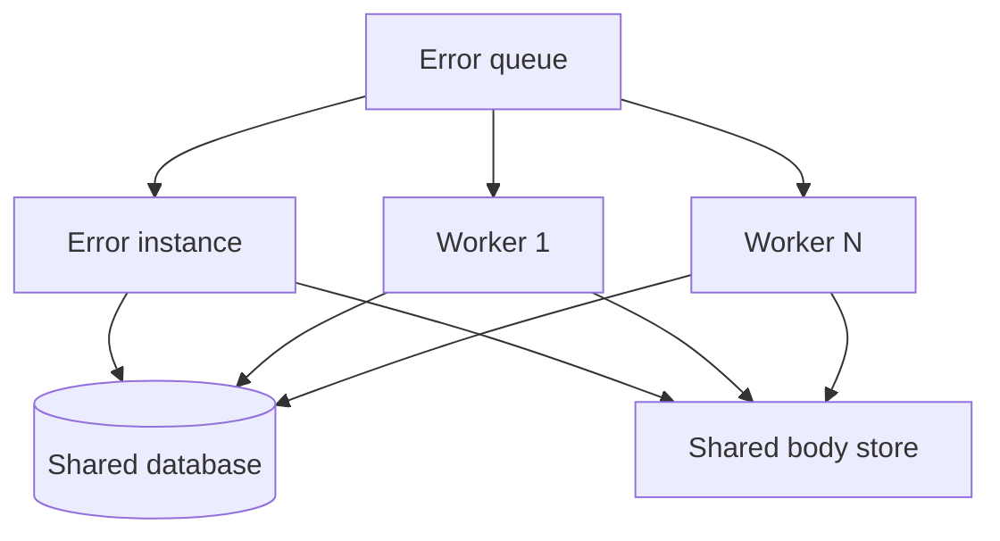

An Error instance that uses [SQL Server or PostgreSQL storage](/servicecontrol/storage/) can share the work of ingesting failed messages with additional ingestion-only worker processes. Workers read from the same `error` queue as the Error instance, so they compete for messages and write them to the same database.

> [!IMPORTANT]
> Scaling out error ingestion is only supported with SQL Server and PostgreSQL storage.

## When to use workers

First tune a single process. See [tune ingestion concurrency and writers](/servicecontrol/servicecontrol-instances/hardware.md#improving-performance-tune-ingestion-concurrency-and-writers) and the [performance tuning settings](/servicecontrol/servicecontrol-instances/configuration.md#performance-tuning).

Add workers only when one process can no longer ingest failed messages fast enough, for example when the `error` queue keeps growing during large bursts of failures. Workers can increase ingestion throughput but also add load on the database, the message body store, and the transport. Measure the combined result; do not assume linear speedup.

## Topology



Exactly one normal Error instance must keep running. It provides the API and integrated ServicePulse, retries, archiving and editing, retention, integration event dispatch, and heartbeat monitoring. Workers do not perform these responsibilities. If the normal instance stops, workers can keep ingesting, but the API and these background services are unavailable.

Workers are not additional Error instances. Unlike independent [Audit instances](/servicecontrol/audit-instances/), which each have their own storage, every worker uses the database, schema, and message body store of the one Error instance. Do not run a second normal Error instance against the same storage.

The transport must allow several consumers on the same queue. Verify this for the transport in use.

## Starting a worker

Start the same ServiceControl Error executable or container image with the `--error-ingestion-only` argument. The mode is selected only by this argument; there is no configuration or environment setting for it.

A worker:

- Workers must use the same database connection as the primary instance.
- Must use the same transport, `Database/ConnectionString`, `Database/Schema`, and `MessageBody/*` settings as the normal instance.
- Ingests failed messages regardless of the `IngestErrorMessages` setting.
- Does not run setup. Combining `--error-ingestion-only` with `--setup` or `--setup-and-run` is refused.
- Hosts no ServiceControl API; it only serves the [health endpoints](#health-and-monitoring).
- Runs with `MaximumConcurrencyLevel` set to `10` unless configured otherwise. See [performance tuning](/servicecontrol/servicecontrol-instances/configuration.md#performance-tuning) for the concurrency, batch size, batch timeout, and parallel writer settings. These apply per worker.

The normal instance and every worker need permission to read, write, and delete bodies in the shared store. Azure Blob Storage and Amazon S3 are shared by design. File system storage works only when the path is a [shared mount](/servicecontrol/storage/external-body/file.md#setup-and-runtime); a per-host or per-container directory leaves messages whose bodies other processes cannot read.

## Container example

Keep the environment variables shared by all processes in a single file. The following example uses an existing RabbitMQ broker, SQL Server database, and Azure Storage account. Replace the addresses and credentials with values supplied by the deployment environment, and ensure the services are reachable from every container. Protect the file because it contains credentials.

```text
# error.env
SERVICECONTROL_TRANSPORTTYPE=RabbitMQ.QuorumConventionalRouting
SERVICECONTROL_CONNECTIONSTRING=host=rabbitmq.example.net;username=...;password=...
SERVICECONTROL_PERSISTENCETYPE=SQLServer
SERVICECONTROL_DATABASE_CONNECTIONSTRING=Server=sqlserver.example.net;Database=ServiceControl;User Id=sc;Password=...
SERVICECONTROL_MESSAGEBODY_STORAGETYPE=AzureBlob
SERVICECONTROL_MESSAGEBODY_AZURE_CONNECTIONSTRING=DefaultEndpointsProtocol=https;AccountName=...;AccountKey=...
```

For PostgreSQL, replace the two database settings with:

```text
SERVICECONTROL_PERSISTENCETYPE=PostgreSQL
SERVICECONTROL_DATABASE_CONNECTIONSTRING=Host=postgresql.example.net;Database=ServiceControl;Username=sc;Password=...
```

For other body store settings and authentication methods, see [external message body storage](/servicecontrol/storage/external-body/).

Run setup once with the normal instance configuration, then start the normal instance and the workers. Replace `{version}` with the ServiceControl version to deploy, and use the same version for every process.

```shell
docker run --rm --env-file error.env particular/servicecontrol:{version} --setup

docker run -d --name servicecontrol --env-file error.env -p 33333:33333 \
    -e SERVICECONTROL_ENABLEINTEGRATEDSERVICEPULSE="true" \
    particular/servicecontrol:{version}

docker run -d --name servicecontrol-worker-1 --env-file error.env \
    particular/servicecontrol:{version} --error-ingestion-only
```

Start further workers the same way with different container names. The normal instance needs the settings described in the [container guide](/servicecontrol/servicecontrol-instances/deployment/containers.md), for example for [remote instances](/servicecontrol/servicecontrol-instances/deployment/containers.md#required-settings-remote-instances). Workers do not need them, and the example does not publish a port for a worker.

## Setup and upgrades

Only the normal instance runs setup. Workers do not create or migrate the database, so the database must be provisioned before the first worker starts.

To upgrade:

1. Stop the workers and the normal instance. All processes must be stopped before the schema is upgraded.
1. Upgrade the normal instance and [run setup](/servicecontrol/servicecontrol-instances/deployment/containers.md#initial-setup) once.
1. Start the normal instance.
1. Upgrade and start the workers.

Run all processes on the same ServiceControl version.

## Health and monitoring

A worker serves only two endpoints, on the same port and with the same HTTPS certificate configuration as other ServiceControl instances:

- `/health` reports that the process is running. Use it for liveness probes.
- `/health/ready` also reports whether this worker is ingesting failed messages. Use it for readiness checks and monitoring. Do not restart a worker because `/health/ready` fails.

These probes do not independently verify shared message body storage. Verify body-store access from every host. A configured HTTPS certificate is used, but a worker does not redirect HTTP requests to HTTPS or send HSTS headers. See [health checks](/servicecontrol/servicecontrol-instances/deployment/containers.md#health-checks) for how the endpoints behave on a normal instance.

The container image's built-in health check calls `/health` on the worker too, so no published port is needed for it. Probe workers from within the container network or the orchestrator. ServicePulse connects only to the normal instance, which shows the `Error Message Ingestion Process` [custom check](/servicecontrol/servicecontrol-instances/#notifications-health-monitoring) of each worker separately.

## Troubleshooting

- **A worker fails to start and mentions SQL Server or PostgreSQL:** the instance is configured with another persistence type, such as `RavenDB`. Check that the worker uses the same `PersistenceType` as the normal instance.
- **A worker fails to start and mentions it runs no setup:** remove `--setup` or `--setup-and-run`. Run setup using the normal instance configuration.
- **Messages ingested by one process are missing from ServicePulse or have no bodies:** check that the normal instance and every worker use the same `Database/ConnectionString`, `Database/Schema`, and `MessageBody/*` settings, and that a file system body store is a shared mount.
- **A worker fails against an outdated schema:** stop all processes, run setup with the normal instance, then start the normal instance and the workers.
