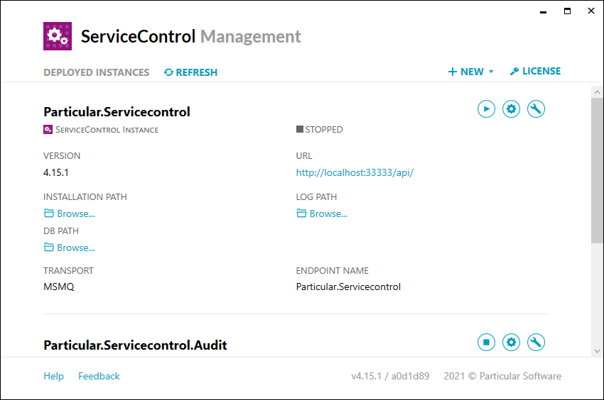

ServiceControl Error and Audit instances store data in a RavenDB database. Some advanced operations require accessing that database directly.

> [!NOTE]
> Accessing RavenDB Studio requires a modern web browser. Internet Explorer is not supported.
>
> The database is intended to be used only by the ServiceControl instance and is not intended for external manipulation or modifications.

How the database is accessed depends on whether ServiceControl is [deployed on Windows](#windows-deployment) or on [containerized infrastructure](#container-deployment).

## Windows deployment

When logged on to the server where ServiceControl is installed, the database is always available, as it is implemented as a separate process.

Access the database at:

* Error Instance: [http://localhost:33334](http://localhost:33334) (or the configured [database maintenance port](/servicecontrol/servicecontrol-instances/configuration.md#ravendb-storage-servicecontroldatabasemaintenanceport))
* Audit Instance: [http://localhost:44445](http://localhost:44445) (or the configured [database maintenance port](/servicecontrol/audit-instances/configuration.md#ravendb-storage-servicecontrol-auditdatabasemaintenanceport))

The database can be accessed without stopping or restarting the ServiceControl instance, though [maintenance mode](#windows-deployment-maintenance-mode) can still be used for some operations.

### Maintenance mode

When running in Maintenance Mode, a Windows ServiceControl instance will only run the database. The API will not be available, and messages will not be ingested from any queues. This is useful to be able to inspect and perform administrative functions on the database without any modifications from the application being possible.

From ServiceControl 7, maintenance mode is supported only with embedded RavenDB, where ServiceControl manages the database process. Error and Audit instances using an external RavenDB server do not start in maintenance mode. Stop the ServiceControl instance and access the external database directly instead, leaving the database server running.
To enable maintenance mode with embedded RavenDB:

1. Launch ServiceControl Management.
2. Click the wrench <kbd> :wrench: </kbd> icon to open Advanced Options.
3. Click **Start Maintenance Mode**.
4. Click the **RavenDB Management Studio** link to access the RavenDB interface.
5. Click **Stop Maintenance Mode**. This stops the instance.
6. Start the instance to resume normal operation.

#### Scripted maintenance mode

Maintenance mode can also be started and stopped from an elevated PowerShell session using the [ServiceControl Management PowerShell module](https://www.powershellgallery.com/packages/Particular.ServiceControl.Management). See [Deploying ServiceControl Error instances using PowerShell](/servicecontrol/servicecontrol-instances/deployment/powershell.md) and [Deploying ServiceControl Audit instances using PowerShell](/servicecontrol/audit-instances/deployment/powershell.md) for installation and prerequisites.

snippet: ps-start-error-maintenance-mode

snippet: ps-start-audit-maintenance-mode

Each command stops the Windows service, sets the maintenance mode setting in the instance's configuration file, and starts the service again. The setting stays in the configuration file until it is cleared. The stop commands stop the service and clear the setting, as **Stop Maintenance Mode** does in ServiceControl Management. The service stays stopped until it is started normally:

snippet: ps-stop-error-maintenance-mode

snippet: ps-stop-audit-maintenance-mode

The `-Name` value is the Windows service name of the instance. The commands have the aliases `sc-startmaintenance`, `sc-stopmaintenance`, `audit-startmaintenance`, and `audit-stopmaintenance`.

## Container deployment

When deployed using containers, the database runs in a separate container than the ServiceControl instance. The database can be accessed at any time on port `8080` of the database container.

To perform database maintenance without ServiceControl modifying the database, stop the ServiceControl container while leaving the database container running.

Do not enable `MaintenanceMode` on the ServiceControl container. From ServiceControl 7, maintenance mode is not supported with an external RavenDB server, including one running in a separate container, and prevents the ServiceControl instance from starting.
