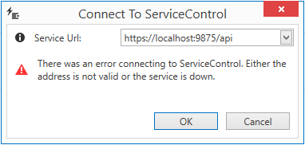

include: serviceinsight-sunset

ServiceControl can be configured to run over a secured connection, but if a self-signed certificate is used for this purpose, ServiceInsight will not connect to that instance by default. While using a self-signed certificate is generally not recommended, ServiceInsight provides an override configuration entry to allow connecting to instances secured with one of these certificates.



Open `ServiceInsight.exe.config` from the installation directory and change the value for the following entry to `True` (the default value is `False`):

```XML
<appSettings>
    <add key="SkipCertificateValidation" value="True" />
</appSettings>
```

> [!NOTE]
> Since the application is installed by default in the `Program Files` folder, administrative privileges might be required to edit the config file above.
